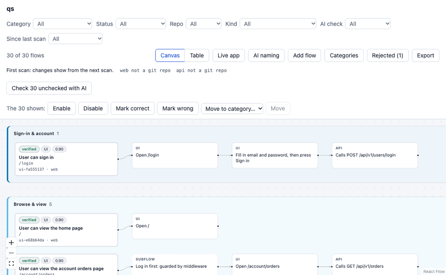

# Flows

Flows reads your app's source code and lists its **user flows and API flows** ("User can sign in", "POST /orders"),
each step with the code behind it. You review them on a local page, then export them as JSON for a test tool.
Flows itself writes and runs no tests, and never runs your code.



Supported: Next.js 14, 15 and 16 (App Router) for the web app; for the API, Express 4 and 5 (TypeScript or
JavaScript, including routing-controllers' decorator controllers), NestJS, and a Next.js app's own API routes
(`app/**/route.ts`, register the folder as an API too: `flows repo add web --role api`). Optionally, point it at the
running app's URL and a read-only explorer cross-checks the flows against what it sees.

## Install

Flows needs Node.js 24.12 or newer. Until it is on npm, install it from a clone:

```bash
git clone https://github.com/Abhijit5815/flows.git
cd flows
npm install
npm run build
npm link
flows setup
```

`flows setup` is the only time Flows downloads anything. It fetches two small models that run on your CPU: an
embedding model (`bge-small-en-v1.5`) and an entailment model (`nli-deberta-v3-xsmall`), about 430 MB in all, from
Hugging Face, each file checked against a checksum. They are kept once per user in `~/.cache/flows/models` (or under
`FLOWS_HOME`), shared by every project and never put in your repo; after that Flows works offline. `flows setup`
also says whether it found a browser (Chrome, Edge or Playwright's Chromium), which only the live-app commands need.
To update: `git pull && npm install && npm run build`.

## Use it on your app

In your app's folder:

```bash
flows init      # asks which LLM to use, then which folders are the web app and the API
flows scan      # reads the code and builds the flows
flows ui        # opens the review page
```

`flows init` lists the local models it finds (Ollama, LM Studio) and offers your **coding assistant** (first choice:
no API key, no model to install, the assistant answers Flows' naming jobs with `flows jobs` and `flows answer`),
the Anthropic or Gemini API (you name the environment variable that holds your key, Flows never stores it), or any
OpenAI-compatible server. Press Enter at a question to skip it. Without a terminal, `flows init` asks nothing; use
`flows repo add <folder> --role web|api` instead. After a code change, run `flows scan` again.

Want to try it first? The package ships a tiny shop (a Next.js app and its Express API):

```bash
cp -r examples/quickstart ~/flows-quickstart && cd ~/flows-quickstart
flows init && flows scan && flows ui
```

(In the init questions, add the folders `web` as web and `api` as api.)

## The review page

`flows ui` shows every flow named for what a user can do, with its page or route beneath. Open one to see each
step and the code, request or screenshot behind it. You can approve, reject, edit, categorise and add flows; your
changes are saved in each repo's `.flows/` folder, so they go into version control with the code.

- **Live app**: open or explore a running app by its address (sign in by hand in the window, even behind SSO).
- **AI naming**: pick the AI and name the flows. **Check with AI** gives a flow a QA review (advice only).
- **Since last scan**: each scan marks flows **new** or **updated**; you can show and export just those.
- **Table** view: search, sort and page through long lists.

## Commands

| Command | What it does |
|---|---|
| `flows init` | Create `.flows/config.json`; on a terminal, asks the LLM and the repos. |
| `flows scan` | Parse the repos and build their flows (unchanged files are cached). |
| `flows ui` | Open the review page. |
| `flows show flows` | Print the flows, with the evidence for every step. |
| `flows export --out flows.json` | Write the reviewed flows as JSON (see below). `--changed`: only new or updated ones. |
| `flows qa [--changed]` | An AI reviews each flow as a QA engineer would and lists the gaps. |
| `flows jobs` / `flows answer` | The AI jobs waiting for your coding assistant, and its answers. |
| `flows explore <url>` | Visit the running app read-only (every write is blocked) and cross-check it with the source. |
| `flows login <url> --as <name>` | Log in once by hand; `explore --as <name>` reuses the session. |
| `flows inspect` | Use the app by hand in a browser window, for what the explorer can't reach. |
| `flows eval`, `flows cost` | The Decider's accuracy and drift; LLM calls and tokens per run. |

`flows help` lists every command.

### What the export holds

Each step carries what a test needs: the request (with the body's fields and rules) and the path parameters' types;
a UI step's action (the fields to fill and the button to press, each with a ready selector); a page's expected
heading; the expected result; and every error with its status, sender, message and when it happens. A "Log in
first" step says how the session is carried (`Authorization: Bearer <data.token>`, or a cookie). A UI flow's API
call carries the check, errors and body of the backend route that answers it, and a call no route answers is
flagged `no backend route`.

## Working as a team

Commit the `.flows/` folders. They hold everything people decided: reviews, edits, added flows, learned rules
(`rules.jsonl`, `flows.jsonl` in each repo) and the LLM's flow names and categories (`answers.jsonl` in the project).
So everyone who scans gets the same flows, and only the first scan of a change waits for the LLM.

Each file gets one line per change and is only ever appended to. The `.gitattributes` Flows writes beside them
tells git to keep both sides' lines, so two people reviewing at once never get a merge conflict. When they judge the
same flow, the later judgment wins; when they edit different fields of one flow, both edits stay.

## AI and privacy

Flows decides most things itself with those two small local models, so nothing leaves your machine for that. The
embedding model compares a piece of text with labelled examples to answer closed questions ("is this button
destructive or safe?", "is this request noise?"), finds code that looks like a flow but wasn't picked up, and
matches a description you type to the code. The entailment model checks that a claim follows from its evidence. An
LLM is used only for flow names, descriptions and the categories the local models can't decide, and every answer
is checked against the code.

- Inside a coding assistant (`"llm": { "provider": "assistant" }`, chosen in `flows init`), the assistant does
  these jobs (`flows jobs`, `flows answer`) and Flows calls no model at all. `skill/flows/SKILL.md` is the Agent
  Skill that tells the assistant how.
- A local model (Ollama, LM Studio) keeps everything on the machine.
- A hosted model needs your own API key, read only from the environment variable the config names.

The live-app commands keep screenshots, requests and saved sessions in Flows' local cache, never in `.flows/`, and
redact tokens and personal data from what they store.

## Development

```bash
npm install
npm test           # unit, fixture and browser tests
npm run typecheck
npm run build      # dist/: plain JavaScript, the data files and the prebuilt review page
npm pack           # builds, then makes flows-<version>.tgz (for publishing)
```

`PLAN.md` is the design and the record of decisions.
